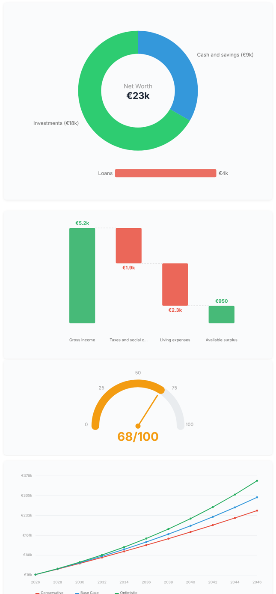

# Wealth Guide Germany

A Claude skill that puts a team of six financial specialists on your case. You answer six short screens of questions about your money. They work in two phases: a diagnostician, a research analyst and a market analyst in parallel, then a strategist, a risk officer and a planner. You get a 12-section wealth plan in euros under German rules, with real amounts, example funds with ISINs, the subsidies you qualify for, and a prioritised action list.

Built for people who are tax resident in Germany. No signup, no API keys, nothing stored.

> **Educational use only.** This is not Anlageberatung, Steuerberatung or Rechtsberatung. Headline figures were checked on **11 November 2026** and will go out of date; rules of thumb and long-standing legal rules come from general knowledge. The skill is instructed to re-check time-sensitive figures on every run, but you remain responsible for verifying anything you act on. For decisions that matter, talk to a Steuerberater, a fee-only adviser or the Verbraucherzentrale.

---

## What you get

| Section | What's in it |
|---|---|
| 1. Summary | Where you stand, where the base case leads, the three things to do first |
| 2. Where you stand | Net worth, cash flow, 0–100 health score with five components |
| 3. Projections | Year-by-year invested assets in three scenarios, in today's euros |
| 4. Strategy blueprint | Three to five ranked strategies with monthly amounts and a verdict each |
| 5. Debt | Cost per month, payoff order, refinancing, mortgage decisions |
| 6. Tax and subsidies | Every allowance and subsidy that applies, what it is worth, how to claim it |
| 7. Monthly money flow | From net income to each pot, plus a year-by-year savings plan |
| 8. Risks | Stress test (equities −40% and six months without income), sensitivity, insurance gaps |
| 9. Action plan | Every action in one table with priority, owner and deadline |
| 10. Market context | Current rates, inflation and market figures with dates and sources |
| 11. Learning path | Three phases matched to your experience |
| 12. Key dates | Tax, subsidy and review deadlines |

Every plan can also be exported as a print-ready HTML page with four charts: a net-worth donut, a cash-flow waterfall, a health-score gauge and three-scenario projection lines. Open it in a browser and print to PDF.

An abridged example with invented figures is in [`examples/sample-plan.md`](examples/sample-plan.md), with its HTML export in [`examples/sample-plan.html`](examples/sample-plan.html).



---

## How it works

```
You ──> 6 interview screens ──> 6 specialists work your case ──> 12-section plan
        (about 3 minutes)        (two phases)                     (document + HTML with charts)
```

### The interview

Six screens of multiple-choice questions: work status and household, goal and basics, income and spending, what you have, debt, risk and protection. You can type exact figures instead of picking a range, and exact figures make the plan better. It asks for your net income directly, so it does not have to guess your tax.

### Optional: your statements

After the interview you can attach account statements, and the plan is then built on your real numbers instead of ranges:

| You attach | The plan gains |
|---|---|
| Bank and credit-card transactions (CSV export, 3 to 12 months) | Real income and spending by category, every recurring payment with its yearly cost, and a short list of savings in euros per year |
| Depot overview and savings plans | A label for every position (core, keep, consolidate, replace, trim), the yearly cost, the tax a sale would trigger, and which savings plans to continue, stop or redirect |
| Payslip, pension and loan statements, tax assessment | Exact figures for net income, pension gap, debt and allowances |

The position review rests on cost, overlap, concentration and tax. It does not predict which shares will rise or fall. Details are in [`workflows/statement-review.md`](workflows/statement-review.md); invented sample files are in [`examples/sample-statements/`](examples/sample-statements/).

### Your team

Think of it as a small wealth management firm working one case.

| Who | What they do for you |
|---|---|
| **The Diagnostician** | Your financial health check. Net income, surplus, savings rate, emergency fund, debt service and pension gap, scored out of 100 against clear benchmarks. Finds what is working and what is bleeding money before anyone else touches your file. |
| **The Research Analyst** | The one who has read everything. Goes through the whole knowledge base (tax, investing, retirement products, property, debt, income, family and estate) and pulls out what applies to someone with your profile, including every subsidy and allowance you qualify for. Also scans recent rule changes so the plan is not built on last year's law. |
| **The Market Analyst** | Eyes on today's numbers. This year's tax and social insurance values, savings and mortgage rates, inflation, equity and property context, and the status of laws that are still pending. |
| **The Strategist** | Designs your playbook. Takes what the first three found and builds three to five distinct strategies, each with a product type, an example fund with ISIN, a monthly amount and the right account to hold it in. |
| **The Risk Officer** | Tries to break your plan. Stress-tests every strategy against a market crash, job loss and rate changes, scores each for risk and fit, and stamps a verdict: RECOMMENDED, PROCEED WITH CAUTION, or NOT SUITABLE FOR THIS PROFILE. |
| **The Planner** | Puts it all together into the 12-section plan with amounts, deadlines and a prioritised checklist, and produces the print-ready HTML version with charts. |

The first three work at the same time. The strategist, risk officer and planner then build on their findings in order, and the risk officer runs separately from the strategist so the plan is not marking its own work. Where no subagent tool is available, Claude does the six passes itself in the same order.

---

## The knowledge base

Seven reference files in [`knowledge/`](knowledge/), written for German rules:

| File | What's inside |
|---|---|
| `tax.md` | How income tax is built up, the 2026 tariff with marginal rates, Soli and church tax, tax classes, deductions employees miss, § 35a, who must file, yearly checklist |
| `investing.md` | Asset allocation by risk, model portfolios, how to choose an ETF, example ISINs, safe assets, Abgeltungsteuer, Teilfreistellung, Vorabpauschale with a worked example, loss pots, using the Sparerpauschbetrag, crypto and gold, what to avoid |
| `retirement.md` | The three layers, statutory pension mechanics, pension-gap method, bAV decision framework, Altersvorsorgedepot from 2027 with a subsidy table, Riester, Rürup, private pension insurance, Frühstart-Rente, health insurance in retirement, priority ladder by profile |
| `property.md` | Buy or rent, purchase costs and Grunderwerbsteuer by Land, affordability, mortgage structure, extra repayment versus investing, KfW programmes, renting out and its tax, risks |
| `money-basics.md` | Budget, emergency fund, debt order and tools, Schufa, insurance priorities, statutory versus private health insurance, consumer rights |
| `income-career.md` | Salary, tax-efficient employer benefits, equity compensation, training, side income and Kleinunternehmer rules, moving into self-employment |
| `family-estate.md` | Couples, children and Elterngeld, powers of attorney, wills, gift and inheritance allowances, caring for parents |

Plus six step-by-step guides in [`workflows/`](workflows/): first investment, getting out of debt, building wealth in stages, buying a home, starting a side income, and reviewing your statements.

`SKILL.md` carries a condensed version of the knowledge base, so it also works as a single file.

---

## Install

### Claude Code

```bash
git clone https://github.com/aniketsahay/wealth-guide-germany.git
mkdir -p ~/.claude/skills
ln -s "$(pwd)/wealth-guide-germany" ~/.claude/skills/wealth-guide-germany
```

Start Claude Code in any directory and type `wealth guide`. If the interview starts, it works.

Needs: web search (to refresh figures) and Python 3.8+ (for the calculations and the HTML export; standard library only, nothing to install).

### Claude app

Add the contents of `SKILL.md` as a skill in your Claude account, then say **"wealth guide"**, **"Finanzplan"** or **"Vermögensplan"** in a chat. The single file is self-contained; the deeper knowledge files, workflows and export script are used when the whole folder is available.

### Calculator on its own

```bash
python3 scripts/calc.py --selftest      # checks the tariff, Soli, subsidy and projection maths
python3 scripts/calc.py profile.json    # health score, net-income estimate, projections, loan payoff
```

All statutory figures the calculator uses sit in one `YEAR` block at the top of the file.

### Statement analyser on its own

```bash
python3 scripts/statements.py --selftest
python3 scripts/statements.py spending examples/sample-statements/giro-sample.csv
python3 scripts/statements.py portfolio examples/sample-statements/depot-sample.csv --allowance 2000
```

### HTML export on its own

```bash
python3 scripts/md_to_html.py path/to/plan.md
```

Writes `plan.html` beside the markdown file. Amounts can be in English (`€12,345`) or German (`12.345 €`) format.

---

## Privacy

Nothing is stored between runs: there is no database. The plan ends with a "Your profile" block you can paste back in next time. The skill is instructed never to put your personal figures into a web search. Your answers are processed by Claude like any other conversation. Statements you attach are handled the same way: analysed in the session, never used in a web search, and the plan carries no account numbers. Share only what you are comfortable sharing, and black out what is not needed.

## Limits

- Germany only. Cross-border income, expat tax questions and other countries are out of scope.
- Figures are a snapshot. Laws marked as pending (for example the crypto holding-period reform and the 2027 social insurance ceilings) may have changed.
- Fund names are examples of a category, not recommendations.
- The review of your holdings looks at cost, overlap, concentration and tax. It does not forecast any share, and it only knows the accounts you showed it.
- If you give ranges instead of exact figures, the plan works from midpoints and marks them as estimates.
- Running six specialists as subagents uses noticeably more of your usage allowance than a single pass.

## Keeping it current

Everything time-sensitive is marked ⟳ in `SKILL.md`. At the start of each year, update at least: the § 32a tariff formula and Grundfreibetrag, the Soli threshold, social insurance ceilings and rates, the Basiszins, Rürup and bAV limits, Kindergeld, the tariff table in `knowledge/tax.md`, the `YEAR` block in `scripts/calc.py`, and the "checked" dates. Pull requests with a source link are welcome.

## Credits and licence

The idea, the six-specialist method and the HTML export script come from [caseonix/wealth-guide](https://github.com/caseonix/wealth-guide) by Srivatsa Kasagar (MIT), which covers the US, Canada and India. The knowledge base, workflows, interview and template here are written for German rules; `scripts/md_to_html.py` is adapted from the original.

MIT licence, see `LICENSE`.
